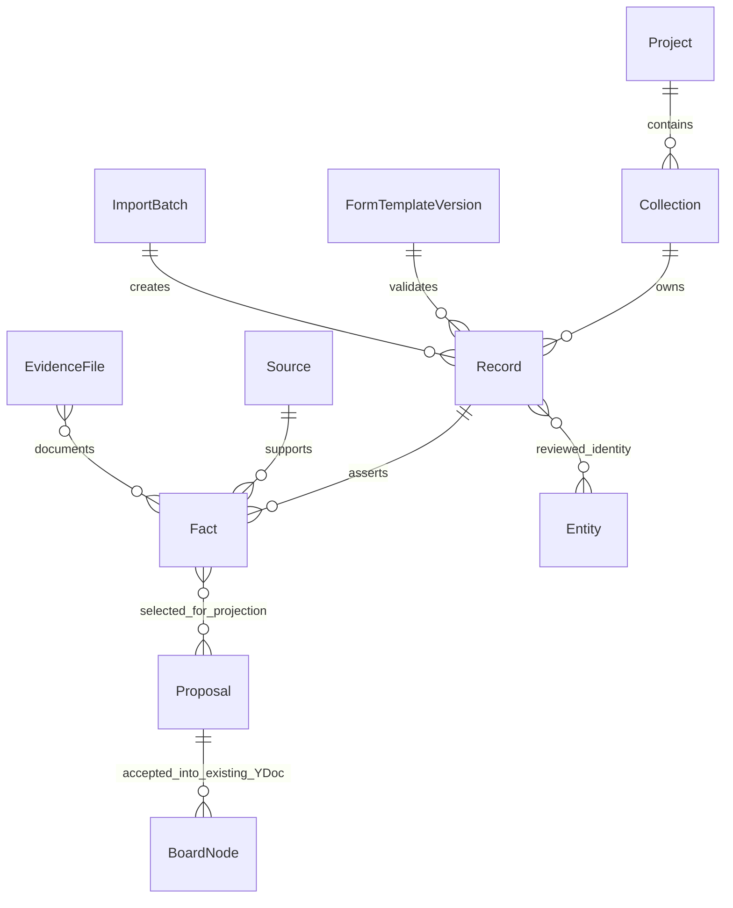
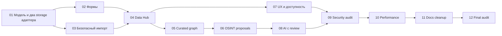

# Raven Data Intelligence — план продолжения, этап 00

Проверено 26 октября 2026 на `58956f2f900d65b7ad701b49085d7cc12c566f7a`
(`origin/main`, PR #83). Это аудит и план, не реализация коллекций. Область первого
PR: этот документ и ссылка в AGENTS. Production и реальные данные не затрагивались.
Статусы: **implemented** — кодовый путь проверен указанными тестами;
**partial** — переиспользуемая часть есть, целевого сценария ещё нет;
**missing** — в проверенных контрактах/схемах отсутствует;
**unverified** — исполнение или внешнее требование не удалось подтвердить.

## 1. Инварианты и модель назначения

Это требования к этапам 01–12, а не утверждение о готовности текущей версии:

- База/коллекция не есть граф. Граф — curated projection выбранных записей и фактов.
- Один человек может иметь много независимых записей-утверждений; одинаковый телефон,
  адрес или имя не доказывает идентичность. Неоднозначность сохраняется до review.
- Источник обязателен на уровне факта; неизвестный источник явно неизвестен, не выдуман.
  Исходное значение, нормализованное значение и решение аналитика различаются.
- Нет тихой отправки пользовательских данных внешним API, AI или инструментам.
  Consent привязан к выбранным данным, назначению и получателю.
- N2: локальный режим без внешнего сервера; N4: proposal → accept → одна undo-транзакция.
- В server режиме организация определяется сессией, не входным `orgId`; каждый read,
  write, search, export, file и background job ограничивается организацией и правами.

Основания: [AGENTS.md:25](../AGENTS.md),
[appMode.ts:38](../packages/config/src/appMode.ts),
[trpc.ts:49](../apps/api/src/trpc/trpc.ts),
[apply.ts:4](../packages/integrations/src/apply.ts).
**partial**: эти механизмы уже существуют для досок, но коллекций пока не обслуживают.

Предлагаемая модель (**missing**, реализовать на этапе 01):

Collection: имя, описание, ответственный, policy/access, retention; Record: стабильный ID,
версия шаблона и ревизия; Fact: field ID, raw/normalized value, источник, evidence,
observedAt, actor/activity, supersedes/conflict. Entity — проверяемая гипотеза идентичности,
не замена исходных записей. ImportBatch хранит hash, mapping, ошибки, источник и ключ
повторного запуска. Графовая ссылка хранит record/fact ID и версию, чтобы показать stale.

## 2. Реестр фактов и повторное использование

Все координаты относятся к проверенному SHA; наличие модуля само по себе не доказывает E2E.

| Область / статус                                                                 | Кодовый путь и фактическое поведение                                                                                                                                                                                                                                                                           | Пробел / действие                                                                                                                                    |
| -------------------------------------------------------------------------------- | -------------------------------------------------------------------------------------------------------------------------------------------------------------------------------------------------------------------------------------------------------------------------------------------------------------- | ---------------------------------------------------------------------------------------------------------------------------------------------------- |
| Person — **partial**                                                             | [person.ts:14](../packages/domain/src/nodes/types/person.ts): displayName, usernames/emails (до 64), notes, organization, location; passthrough. [person.ts:71](../packages/domain/src/nodes/types/person.ts): identity keys                                                                                   | Нет типизированных телефонов, адресов, отдельных фактов/источников. Не выводить идентичность человека из совпадения ключа                            |
| Registry/inspector — **partial**                                                 | [registry.ts:33](../packages/domain/src/nodes/registry.ts): unknown fallback; [Inspector.tsx:2](../apps/web/src/nodes/inspector/Inspector.tsx): generic descriptors и undo                                                                                                                                     | Registry типов графа — не пользовательский конструктор форм. Нужны стабильные field ID, версии шаблонов и валидация записей                          |
| Templates — **implemented** для досок, **missing** для форм                      | [boardTemplates.ts:18](../packages/domain/src/templates/boardTemplates.ts): nodes/edges; [types.ts:164](../apps/web/src/data/workspace/types.ts): createBoard/templateId                                                                                                                                       | Новый FormTemplateVersion отдельно от board template; не перегружать JSON доски                                                                      |
| Workspace — **implemented** для local, **unverified** для полного server runtime | [types.ts:147](../apps/web/src/data/workspace/types.ts): проекты/доски; [local.ts:46](../apps/web/src/data/workspace/local.ts): IndexedDB stores; [server.ts:42](../apps/web/src/data/workspace/server.ts): tRPC adapter                                                                                       | Collection/Record API **missing** в этом контракте. Добавить одинаковую семантику двух адаптеров                                                     |
| Persistence — **partial**                                                        | [persistence.ts:18](../apps/web/src/data/persistence.ts): отдельное IndexedDB имя доски; [opfs.ts:174](../apps/web/src/data/opfs.ts): blob store                                                                                                                                                               | Коллекции требуют собственного versioned storage и quota/recovery, не помещения всей базы в board Y.Doc                                              |
| Provenance/связи — **partial**                                                   | [provenance.ts:29](../packages/domain/src/entities/provenance.ts): node/edge provenance, source nullable; [suggestLinks.ts:26](../packages/domain/src/edges/suggestLinks.ts): string-поля и теги → evidence tokens                                                                                             | Нет обязательного provenance каждого значения. suggestLinks не читает массивы emails/usernames и не является record linkage                          |
| Upload — **partial**                                                             | [policy.ts:22](../packages/domain/src/files/policy.ts): caps, MIME; [upload.ts:122](../apps/web/src/files/upload.ts): очередь; localTransport тесты проходят                                                                                                                                                   | MIME CSV/XLSX разрешён как файл, но это не импорт строк. Нужны parser worker, preview, mapping и row errors                                          |
| Board import — **implemented**                                                   | [ImportDialog.tsx:21](../apps/web/src/app/board/ImportDialog.tsx): readImportFile; [importBoard.ts:1](../packages/domain/src/export/importBoard.ts): импорт графа                                                                                                                                              | Сохранить `.raven.json`; табличный импорт — отдельный сценарий                                                                                       |
| Engines/AI — **partial**                                                         | [apply.ts:43](../packages/integrations/src/apply.ts): selected items/conflicts; [identity.ts:31](../packages/integrations/src/resolve/identity.ts): normalizers; [normalize.ts:82](../packages/query-engine/src/normalize.ts): canonicalValue; [proposal.ts:30](../packages/ai/src/proposal.ts): AI provenance | Переиспользовать orchestrator/proposals, согласовать разные normalizers. Нет доказанного Data Intelligence pipeline                                  |
| UI/граф — **partial**                                                            | [schema.ts:18](../packages/domain/src/doc/schema.ts): существующие roots; [projections.ts:1](../apps/web/src/views/projections.ts): представления графа; [04_DESIGN_SYSTEM.md:1513](../RAVEN-SPEC/04_DESIGN_SYSTEM.md): таблицы                                                                                | Data Hub и формы **missing**. Существующие views не являются независимой базой. Использовать текущий canvas и @nexus/ui                              |
| Tenant isolation — **partial**                                                   | [project.ts:53](../apps/api/src/trpc/routers/project.ts): org-filter; [schema.prisma:75](../packages/db/prisma/schema.prisma): Membership; [schema.prisma:134](../packages/db/prisma/schema.prisma): Project                                                                                                   | Для новых сущностей нужны запреты cross-org, jobs/files/export, composite FK. DB RLS из спеки не считать реализованным без миграций и runtime-тестов |

**Расхождения документов и кода:**
[25_IMPLEMENTATION_STATUS.md:114](../RAVEN-SPEC/25_IMPLEMENTATION_STATUS.md) говорит об отсутствии
GitHub интеграции, но уже строка 20 описывает backend; существует
[RepositoryAnalysisSection.tsx:12](../apps/web/src/integrations/RepositoryAnalysisSection.tsx).
Строка 304 объявляет views отсутствующими, хотя `views/projections.ts` и его тесты существуют.
Это **partial**, не доказательство готовности всего UI.
[15_SECURITY.md:810](../RAVEN-SPEC/15_SECURITY.md) запрещает SVG в allowlist, но
[policy.ts:52](../packages/domain/src/files/policy.ts) разрешает SVG: безопасность serving/intake
**unverified**, а не автоматически подтверждённая уязвимость.
[15_SECURITY.md:414](../RAVEN-SPEC/15_SECURITY.md) описывает `tenant.ts`/RLS;
поиск в `packages/db` не нашёл этого wrapper или SQL политик. Изоляция приложения есть,
полная DB defense-in-depth **unverified**. Не исправлять исторический трекер массово в этом PR.

## 3. Зависимости, миграции и проверяемые этапы

Security/retention проверять с 01, этап 09 — повторный аудит, не отсрочка защиты.
Заголовки этапов восстановлены из задания владельца: файл
`RAVEN_OSINT_CONTINUATION_PROMPTS_RU.md` в checkout не найден (**unverified** полные задания 01–12).

**Миграционные риски и ограничения:** [08_DATA_MODEL.md:1774](../RAVEN-SPEC/08_DATA_MODEL.md)
задаёт additive-first, [doc/migrations.ts:20](../packages/domain/src/doc/migrations.ts) даёт runner.
Новая модель пока **missing**. В 01: отдельные IndexedDB stores + upgrade fixture; additive
Prisma tables/indexes с org/project scope; никаких destructive column changes.
В 02: immutable template versions, переименование по field ID, preview изменения типа.
В 03: resumable batch/chunk commits, стабильный hash+mapping+batch id, duplicate replay tests;
crash между OPFS и metadata не должен оставлять видимые неготовые записи.
В 05: reference/version вместо копии всей базы; удаление/исправление факта помечает projection stale;
принятие предложения undo не удаляет исходный импорт. Старые Y.Doc и board exports round-trip
без добавления нового root в schema v1. Старые provenance нельзя выдавать за известные fact sources.
В 10: измерять память, время импорта/фильтра, cancel, 10k/100k записей и canvas отдельно;
не создавать 100k DOM/graph nodes ради таблицы. Новые runtime зависимости выбирать после license,
maintenance и signature/checksum проверки; parser библиотеки пока не выбраны (**unverified**).

## 4. Угрозы и acceptance tests

Планируемые controls **missing** для новой модели; ориентиры в
[15_SECURITY.md:775](../RAVEN-SPEC/15_SECURITY.md) и
[15_SECURITY.md:1301](../RAVEN-SPEC/15_SECURITY.md).

- Upload: forged MIME, polyglot, XLSX ZIP bomb/path traversal, malformed JSON, prototype keys,
  formula injection при export. Tests: caps по bytes/rows/cells/decompressed bytes/time,
  отказ макросам/внешним ссылкам, формулы не исполняются, ошибка строки не искажает остальные.
- Privacy: каждое отправляемое поле видно в preview; test нулевых outbound requests в local
  и без consent; источник с запрещённой policy не попадает в export/engine/AI.
  Нелегально полученные дампы/утечки не становятся поддерживаемым workflow.
- Identity: одинаковые ФИО/общий телефон/противоречивый адрес → uncertain candidates;
  accept/reject сохраняют evidence и actor; ни score, ни AI не сливают записи автоматически.
- Access: запросы другой организации, viewer write, чужой file ID, forged job scope → отказ;
  audit не содержит raw PII, токены и содержимое документов. Retention/delete/export проверяются
  на metadata, blobs, search indexes и projections, без обещания стирать чужую независимую копию.
- Getcontact допустим как вручную названный Source. Официальный connector **unverified**:
  до проверки лицензии/согласия не добавлять API, scraping или массовый reverse lookup.

Исследовательские ориентиры (не заявление о прочтении):
[PROV-O](https://www.w3.org/TR/prov-o/) → Entity/Activity/Agent и derivation;
[OpenRefine](https://openrefine.org/docs/technical-reference/reconciliation-api) → review кандидатов;
[OWASP Upload](https://cheatsheetseries.owasp.org/cheatsheets/File_Upload_Cheat_Sheet.html) → parser limits.
26 октября доступ ко всем трём URL заблокирован proxy CONNECT 403 (**unverified** тексты).
[Christen](https://doi.org/10.1007/978-3-642-31164-2),
[Fellegi–Sunter](https://doi.org/10.1080/01621459.1969.10501049),
[Browne](https://doi.org/10.1007/s10207-024-00868-2),
[Shneiderman](https://doi.org/10.1109/VL.1996.545307),
[NIST SSDF](https://csrc.nist.gov/pubs/sp/800/218/final),
[ASVS 5](https://asvs.owasp.org/), [Privacy Framework](https://www.nist.gov/privacy-framework),
[GDPR](https://eur-lex.europa.eu/eli/reg/2016/679/oj),
[Fluent 2](https://fluent2.microsoft.design/design-principles),
[Getcontact terms](https://getcontact.com/en/terms)/[privacy](https://getcontact.com/en/privacy)
— очередь проверки (**unverified**), не доказательства текущей реализации.
Перед архитектурным ADR проверить доступные первоисточники/аннотации, записать применённый
вывод и соответствующий test. Платные книги/статьи целиком не читались. Новый ADR пока не принят.

## 5. Десять конечных user journeys

Каждый пункт — отдельный будущий E2E в обоих режимах; статус относится ко всему сценарию.
Основания пробелов — контракт Workspace (`types.ts:147`) и node schema (`person.ts:14`) выше.

1. **missing**: создать именованную коллекцию, перезагрузить offline, найти её снова.
2. **missing**: выбрать «Человек», создать запись с двумя адресами/телефонами и источниками фактов.
3. **missing**: создать свою форму, переименовать поле, открыть старую запись без потери значения.
4. **missing**: импорт CSV/TSV с encoding/mapping preview, исправить ошибку, повторить без дублей.
5. **missing**: импорт JSON/NDJSON/XLSX с лимитами, cancel и отчётом частичного успеха.
6. **partial**: приложить PDF/DOCX/TXT как evidence, открыть безопасный preview, вручную принять
   извлечённую цитату с местом в документе; upload существует (`upload.ts:122`), extraction не доказан.
7. **missing**: фильтр/редактирование в Data Hub, конфликтующие факты и история видны после reload.
8. **partial**: выбрать записи → preview projection → принять → исследовать в текущем canvas → undo;
   board proposal/import уже существует (`apply.ts:43`), связи с коллекцией нет.
9. **partial**: получить uncertain candidates от OSINT/AI, сравнить источники, отклонить/подтвердить;
   старые proposals есть, identity workflow новых записей отсутствует (`identity.ts:31`).
10. **unverified**: две организации не видят чужие коллекции/files/search; viewer не пишет;
    retention/export/delete действуют сквозным образом. Нужны реальные DB/API/browser тесты.

## 6. Baseline и условия завершения 00

Команды выполнялись на Node 22.23.4 / pnpm 9.15.9 с frozen lockfile.

| Проверка                                                                        | Результат текущего запуска                                                                                                                                                                                                                                |
| ------------------------------------------------------------------------------- | --------------------------------------------------------------------------------------------------------------------------------------------------------------------------------------------------------------------------------------------------------- |
| `pnpm install --frozen-lockfile --store-dir /workspace/.raven-tools/pnpm-store` | **pass**, повторный запуск idempotent; lockfile не изменён                                                                                                                                                                                                |
| `pnpm --filter @nexus/web build`                                                | **pass**, initial JS 215.9 KB gzip при budget 250 KB                                                                                                                                                                                                      |
| `pnpm dev:local --host 127.0.0.1 --strictPort` + HTTP GET                       | **pass**, HTML Raven и entry module; это не browser E2E                                                                                                                                                                                                   |
| `pnpm --filter @nexus/web exec vitest run --maxWorkers=2`                       | **pass**, 108 файлов / 715 тестов; есть React act/canvas-jsdom warnings                                                                                                                                                                                   |
| `pnpm --filter @nexus/domain exec vitest run --maxWorkers=2`                    | **pass**, 58 файлов / 677 тестов, включая templates/export/edges                                                                                                                                                                                          |
| `pnpm test`                                                                     | **blocked / exit 1**, turbo останавливается на db build; завершились plugin-sdk 12, ai 64, config 76, ui 77, layout 80, bench 6, transforms 285, canvas-engine 342, query-engine 179, integrations 390 тестов. Незавершённые suites не объявлены зелёными |
| `pnpm lint`                                                                     | **fail / exit 1**, db: 7 unsafe-any errors, клиент Prisma не сгенерирован                                                                                                                                                                                 |
| `pnpm --filter @nexus/web lint`                                                 | **fail / exit 1**, 15 unsafe-any errors в context.tsx:72–84; типы tRPC зависят от db. Повторить с корректным Prisma client, до этого не объявлять отдельным дефектом продукта                                                                             |
| `pnpm typecheck`, `pnpm build`                                                  | **blocked / exit 1**, prisma generate: DNS EAI_AGAIN для binaries.prisma.sh; прямая proxy-проверка checksum URL даёт CONNECT 403. TLS/checksum проверки не отключались                                                                                    |
| `pnpm check:gates`                                                              | **pass**, все пять gates, включая bundle secrets и migration safety                                                                                                                                                                                       |
| `pnpm depcruise`                                                                | **pass / exit 0**, 955 modules, 0 errors, 1 warning: test/factories.ts orphan                                                                                                                                                                             |
| PostgreSQL prerequisite                                                         | **pass**, отдельный disposable pgvector:pg16 container, pg_isready и CREATE EXTENSION vector; production volumes не используются                                                                                                                          |
| Полный server stack                                                             | **blocked**, нет рабочего Prisma client; PostgreSQL отдельно не доказывает readiness API/Redis/MinIO/runner/sync                                                                                                                                          |
| `E2E_NO_SERVER=1 pnpm e2e`                                                      | **blocked / exit 1**, global setup ждёт /readyz 90 s и получает fetch failed; ни один browser scenario не исполнился. Использован существующий local Vite, он не выдаётся за server mode                                                                  |
| Coverage / visual / performance / fresh-task restore                            | **unverified**, в этом docs-only этапе не запускались; unit bench tests не равны browser performance budget                                                                                                                                               |

Прямой запуск `APP_MODE=server pnpm --filter @nexus/api start` с disposable CI defaults
также завершился exit 1: `@prisma/client did not initialize yet` (`client.ts:33`).

GitHub: HTTPS `git fetch`/`ls-remote` работают; `git push --dry-run` принимает новую feature ref.
`gh api repos/...` и `branches/main/protection` получают Forbidden; отдельный curl к
`api.github.com` получает proxy CONNECT 403. `gh auth status` также сообщает invalid GH_TOKEN,
но за proxy это ещё не доказательство отсутствия прав владельца. Секреты не выводились.
Permissions, protection, required reviews, удалённый CI и merge SHA **unverified**.
В черновик среды добавлены только `api.github.com` и `binaries.prisma.sh`; сохранение черновика
не применяет runtime policy. Для продолжения нужны доступный API и проверенная генерация Prisma;
если после сетевого исправления API вернёт 401, обновить GitHub binding в настройках среды.

После снятия блокировок: generate → повторить lint/typecheck/test/build → server services и
migrations на disposable DB → server E2E → PR checks → squash merge без обхода review/protection →
проверить remote main SHA и CI. Этап 00 до этого **не завершён**; этап 01 не начинать автоматически
вместо заблокированного review/merge. Новые пользовательские сценарии в этом PR не реализуются.
